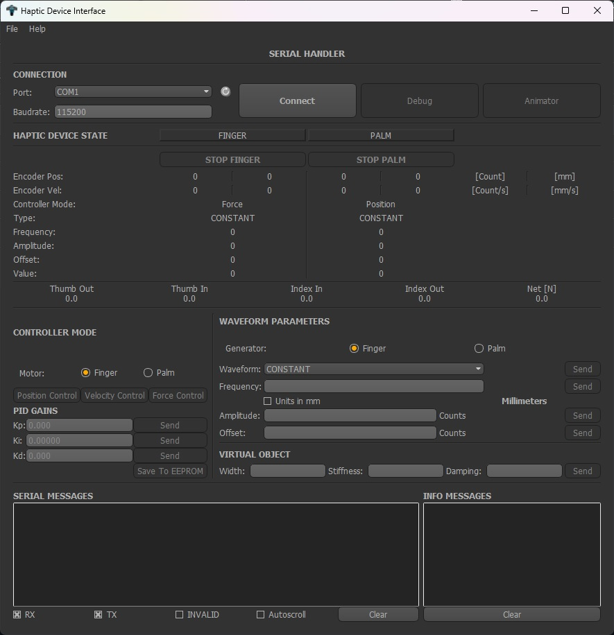

# Desktop App for Controlling the Haptic Device
This is a desktop application for controlling the haptic device. It is written in Python and uses the [PyQt5](https://pypi.org/project/PyQt5/) library for the GUI.
<!-- SS Image -->


## Running the .exe

`HapticDeviceInterface.exe` runs on Windows without Python. Download it from the artifacts of the latest [Tests run](https://github.com/bataseven/Haptic-Device/actions/workflows/tests.yml). Unexpected errors are shown in a dialog and written to `stderr-HapticDeviceInterface.exe` in the temporary folder (`%TEMP%`).

## Running from the source

The app is used on Windows with Python 3.11. In this folder:

```
pip install -r requirements.txt
python app.pyw
```

You can also double-click `app.pyw` to run it without a console window. Unexpected errors are then shown in a dialog and written to `stderr-app.pyw` in the temporary folder.

## Building the .exe

```
pip install -r requirements-build.txt
pyinstaller HapticDeviceInterface.spec
```

The .exe is written to `dist/`. Build it in a virtual environment that only has these requirements: PyInstaller bundles every optional package it finds, so a build from a Python with many packages can be several hundred MB instead of about 50 MB.

## Using the app

1. Connect the device over USB and flash the firmware first if needed (see [the firmware README](../Microcontroller/README.md)).
2. Select the port of the device and click **Connect**. The device sends its gains, limits and controller modes, and the app shows them.
3. Choose the motor (finger or palm) and the controller mode, then send gains, a waveform or a virtual object.
4. Click **Disconnect** or close the app when you're done.

While it is connected, the app sends a heartbeat to the device every 250 ms. If the device doesn't receive anything from the app for 1 second, for example because the app crashed, it stops the motors (the LED turns purple) and the app shows a message.

## Features

- **Motor status:** position and velocity of each motor in encoder counts and mm. Clicking a motor's name homes it.
- **Controller:** controller mode and PID gains of each motor. **STOP FINGER** and **STOP PALM** brake a motor until you release it.
- **Waveform:** type, frequency, amplitude and offset of the reference signal of each motor. Tick **Units in mm** to enter the amplitude and offset in mm instead of encoder counts.
- **Virtual object:** width, stiffness and damping of the object the finger touches.
- **Animator:** live plot of the received values.
- **File > Record Data...:** records the received values to a CSV file for a given duration.
- **File > Settings...:** message characters, count to mm factors and position limits.
- **Serial messages:** the received (RX) and sent (TX) messages. **Help > Show Serial Commands...** lists the message types, and the [firmware README](../Microcontroller/README.md#serial-protocol) describes them in detail.

## Recorded data

Each row of a recording is one status update from the device (40 per second). The columns are:

- the data point number
- **Time:** when the app received the update, in seconds since 1970
- for the finger, then the palm: position and velocity (encoder counts), controller mode, the 9 PID gains, and the waveform type, frequency, amplitude, offset and current value
- the forces of the 4 sensors (N)
- **Device Time:** when the device read the values, in seconds since the device started. Use this column for the time between samples, because "Time" also includes the USB transfer and processing delays.

Recordings made with versions of the app from before October 2026 have the "Wave Amplitude" and "Wave Frequency" labels swapped in the header, and some have other header problems. To fix the header of old recordings (a `.bak` copy of each changed file is kept):

```
python tools/fix_recording_headers.py <folder with the recordings>
```

## Tests

The tests in `tests/` check the message parsing, the data recorder, the serial connection and the header fix tool without a device. In this folder:

```
python -m unittest discover tests
```
