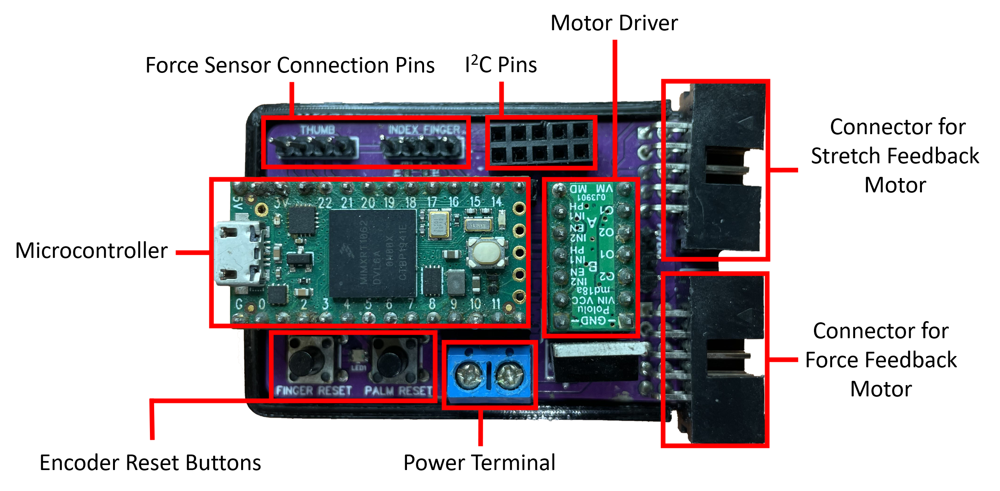

# Software Running on the Microcontroller
This directory contains the software running on the teensy microcontroller. The microcontroller reads the encoder and force sensor data. It also communicates with the computer via serial communication to send the data to computer and receive the control signal from the computer.


## Building and uploading

The firmware is a [PlatformIO](https://platformio.org/) project for the Teensy 4.0.

1. Install PlatformIO, either the VS Code extension or the command line tool (`pip install platformio`).
2. Connect the Teensy over USB.
3. In this folder, build and upload:

   ```
   pio run --target upload
   ```

   The libraries listed in `platformio.ini` are downloaded on the first build.

After the upload, the LED blinks yellow until a program opens the serial port. Then the palm motor homes itself and the force sensors are zeroed, so don't touch the force sensors while the device starts.

Options at the top of `src/main.cpp`:

| Define | Effect |
|---|---|
| `ENABLE_ROS` | Communicate over rosserial instead of the serial protocol below. It has not been used in a while. |
| `USE_SERIAL1` | Use `Serial1` (the Bluetooth module) instead of USB. |
| `RAINBOWS` | Run the LED test program instead of the device firmware. |

## Code layout

| Library in `lib/` | Purpose |
|---|---|
| `HapticDevice` | Puts the parts together and runs the finger and palm control loops |
| `MotorWithEncoder` | Position, velocity and force PID control of a DC motor with an encoder, position limits, homing |
| `WaveformGenerator` | Constant, square, sawtooth, triangular, sinusoidal and trapezoidal reference signals |
| `PressureSensor` | Force from a force sensing resistor, with a moving average and a zero offset |
| `AdmittanceController` | Converts a force error to a reference velocity (off by default, see `useAdmittanceControl`) |
| `FunctionalButton` | Click, double click, hold and double hold detection |
| `SerialHandler` | The serial protocol below |
| `ROSHandler` | The rosserial alternative to `SerialHandler` |

The control loops run at 1 kHz in a timer interrupt. Reading the sensors, the serial port and the buttons happens in `loop()`.

## Unit tests

The tests in `test/` check the waveform generator, the PID controller and the force sensor calibration on the computer, without the device. `test/native_stubs` replaces the Arduino core and the Encoder library. They need gcc, so run them on Linux, macOS or in WSL on Windows:

```
pio test -e native
```

## Pins

| Pin | Connected to |
|---|---|
| 8, 9 | Finger motor driver (phase, enable) |
| 3, 4 | Finger encoder (A, B) |
| 14, 15 | Palm motor driver (phase, enable) |
| 21, 20 | Palm encoder (A, B) |
| 2 | Palm limit switch, used for homing |
| A9, A8 | Thumb inner and thumb outer force sensors |
| A3, A2 | Index inner and index outer force sensors |
| 10 | Finger button |
| 12 | Palm button |
| 5 | Status LED (WS2811) |

The motors are driven with 18 kHz PWM.

## Buttons

| Action | Finger button | Palm button |
|---|---|---|
| Click | Sets the finger encoder position to 0 | Sets the palm encoder position to 0 |
| Hold | Moves the finger towards the upper limit | Moves the palm up |
| Double click and hold | Moves the finger towards the lower limit | Homes the palm |

## LED colors

| Color | Meaning |
|---|---|
| Blinking yellow | Waiting for a program to open the serial port |
| Orange | The serial port is not open |
| Green | Connected |
| Blue | The finger is touching the virtual object |
| Purple | The motors are stopped because the program stopped sending messages (see the host timeout below) |
| White | A button is held |
| Pink, for 0.5 s | An encoder position was set to 0 |
| Off | A button is double clicked and held |

## Safety features

- **Position limits.** Each motor has soft limits, where the motor coasts, and hard limits, where it brakes. They can be changed with the `L` message or in the Settings window of the desktop app.
- **Stop.** The `S` message, or the STOP buttons of the desktop app, brake a motor until it is released.
- **Host timeout.** After a program sends `T1000`, the device expects a message at least every 1000 ms. If none arrives, it releases the motors, sets the waveforms to constant 0, removes the virtual object and sends `X`. The next message of any kind resumes. The desktop app arms it when it connects, sends a heartbeat (`A`) every 250 ms, and disarms it (`T0`) when it disconnects. It is off unless a program arms it, so programs that don't use it are not affected.
- **Watchdog.** If `loop()` or the control loop stops running for 1 second, the microcontroller resets. During the reset the motor driver inputs are not driven, so the motors are not powered.

## Serial protocol

Every message starts with `<` and ends with `>`. The first character is the message type. Values are separated by `#`. Motor and generator index 0 is the finger, 1 is the palm. Controller modes are 0: position, 1: velocity, 2: force.

### Sent to the device

| Type | Format | Example | Effect |
|---|---|---|---|
| `C` | `C` program | `C1` | The connected program: 0 for Unity, 1 for the desktop app. `C1` also makes the device send its gains, limits, controller modes and unit factors. |
| `O` | `O` motor mode | `O02` | Sets the controller mode of a motor |
| `K` | `K` P/I/D motor `#` gain | `KP1#0.5` | Sets a PID gain of the motor's current controller mode |
| `W` | `W` T/F/A/O generator `#` value | `WF1#0.5` | Sets the type, frequency (Hz), amplitude or offset of a waveform. Types are 0: constant, 1: square, 2: sawtooth, 3: triangular, 4: sinusoidal, 5: trapezoidal. |
| `P` | `P` width `#` stiffness `#` damping | `P50000#2.5#0.1` | Sets the virtual object. The width is in encoder counts. With a stiffness of at least `RIGID_BODY_STIFFNESS_THRESHOLD` the object is rigid: a separate position controller (`RIGID_BODY_KP/KI/KD` in `HapticDevice.h`) holds the finger at its surface. |
| `L` | `L` S/H motor lower `#` upper | `LS01000#2000` | Sets the soft (`S`) or hard (`H`) position limits in encoder counts |
| `S` | `S` motor 0/1 | `S01` | Stops (1) or releases (0) a motor |
| `H` | `H` motor | `H1` | Homes a motor. Only motors with a limit switch (the palm) can be homed. |
| `T` | `T` milliseconds | `T1000` | Arms the host timeout. `T0` disarms it. |
| `A` | `A` | `A` | Heartbeat. Does nothing, but resets the host timeout like any message. |
| `B` | `B` 0/1 | `B1` | Turns the debug output on or off |
| `G` | `G` width `#` speed `#` force | `G0.5#0.5#0.5` | State of a Schunk WSG 50 gripper, for teleoperation setups |

### Sent by the device

40 times per second, on one line:

| Type | Format | Example | Content |
|---|---|---|---|
| `R` | `R` microseconds | `R123456789` | Device time when the values of the line were read. It overflows every 71.6 minutes. Only to the desktop app. |
| `H` | `H` motor position `#` velocity | `H01A#-3` | Encoder position (counts) and velocity (counts/s) in hexadecimal |
| `N` | `N` force | `N1.25` | Net finger force (N) |
| `F` | `F` thumb outer `#` thumb inner `#` index inner `#` index outer | `F0.50#0.00#0.00#0.10` | Forces of the sensors (N). Only to the desktop app. |
| `W` | `W` generator value | `W15000.00` | Current output of a waveform. Only to the desktop app. |
| `D` | `D` force | `D2.00` | Desired finger force (N). Only to Unity. |

When requested or changed:

| Type | Format | Example | Content |
|---|---|---|---|
| `K` | `K` motor Kp `#` Ki `#` Kd for position, then velocity, then force | `K01.00#0.000000#6.00#...` | PID gains of all controller modes |
| `L` | `L` S/H motor lower `#` upper | `LS00#160000` | Position limits |
| `M` | `M` motor mode | `M02` | Controller mode |
| `U` | `U` finger `#` palm | `U0.000296452618#0.005973945762` | Factors that convert encoder counts to mm |
| `X` | `X` milliseconds | `X1000` | The motors were stopped because of the host timeout |
| `B` | `B` 0/1 | `B1` | Debug output was turned on or off |
