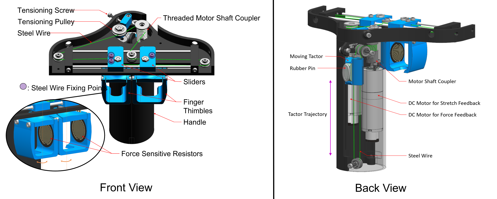

# Haptic Device

During my master's degree, I worked on a developing a haptic device for a virtual reality application. The device was designed to simulate the stiffness and the inertia of virtual objects. 
<table>
  <tr>
    <td></td>
  </tr>
</table>

<!-- put Theses.pdf link -->
You can find the detailed information in my [thesis](Thesis.pdf).

We evaluated the stiffness rendering performance of the device through sets of psychophysical experiments in [this paper](https://ieeexplore.ieee.org/document/10272716).

## Repository layout

| Folder | Contents |
|---|---|
| [Microcontroller](Microcontroller) | Firmware of the Teensy 4.0 on the device (PlatformIO project) |
| [Desktop App](Desktop%20App) | PyQt5 app to control the device, plot its data and record it |
| [Images](Images) | Images used in the READMEs |

## Getting started

1. Build and upload the firmware: see [Microcontroller/README.md](Microcontroller/README.md).
2. Run the desktop app: download `HapticDeviceInterface.exe` from the artifacts of the latest [Tests run](https://github.com/bataseven/Haptic-Device/actions/workflows/tests.yml), or run it from the source as described in [Desktop App/README.md](Desktop%20App/README.md).
3. Connect the device over USB, select its port in the app and click **Connect**.

The messages between the device and the app are listed in the [serial protocol](Microcontroller/README.md#serial-protocol) section of the firmware README.
